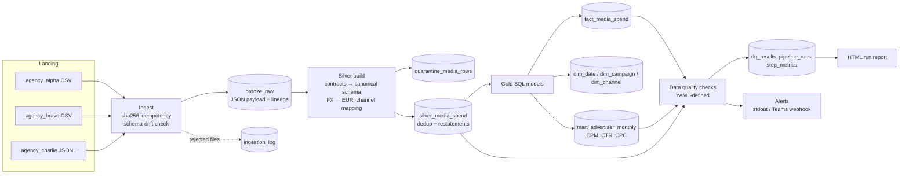

# Media Spend Data Platform

A small but production-shaped data platform for the core problem a media
investment analysis business has: **many agencies deliver the same facts —
what was bought, where, and what it cost — in many different, messy formats,
and clients need one trusted, reconciled view of it.**

It runs locally in seconds (Python + DuckDB, no cloud account needed), but every
design decision maps 1:1 onto a cloud lakehouse (see *Path to production*).

```bash
pip install -e ".[dev]"
make demo     # first delivery → idempotent rerun → late file arrives
make test     # 19 unit + end-to-end tests
make hooks    # run local CI automatically before every git push
open data/reports/latest.html
```

---

## The scenario

Three fictional agencies deliver weekly files for September 2026:

| Feed | Format | Quirks |
|---|---|---|
| `agency_alpha` (NL) | CSV, `,` | EUR, ISO dates, sends a **v2 restatement** of week 2 |
| `agency_bravo` (UK) | CSV, `;` | GBP per row, `DD/MM/YYYY`, **decimal commas** |
| `agency_charlie` (US) | JSON lines | USD, `MM/DD/YYYY`, last file **arrives late** |

Real-world problems are injected on purpose, and each one is handled by a
specific mechanism:

| Injected problem | What the platform does |
|---|---|
| Exact duplicate rows | Collapsed by natural-key dedup in silver |
| Restated week (v2 file) | Latest delivery wins per natural key; lineage shows which file |
| Negative spend, impossible date (31/09), empty campaign id, unmapped channel `radio` | Row-level **quarantine** with a reason; rest of the file still loads |
| Campaign id missing from campaign master | Kept as an **inferred dimension member**, flagged by a check |
| Clicks > impressions | Soft-rule **warning** (suspicious, not impossible) |
| 100× fat-finger spend | Statistical **spike check** (>10× median for source+channel) |
| Agency file late | **Freshness** check warns; clears automatically when the file lands |
| File missing a required column | **Schema drift**: file rejected at ingest + alert, other files unaffected |

## Architecture



### Layers

- **Bronze** (`src/msp/ingest.py`) — files land exactly as delivered, one JSON
  payload per row, with `file_id / file_name / row_num` lineage. Files are keyed by
  SHA-256, so reruns and re-sent identical files never double-load. Each file is
  one transaction. A file missing a contract column is rejected, not half-loaded.
- **Silver** (`src/msp/transform.py`) — **data contracts** in
  `config/sources.yml` map every feed to one canonical schema (dates, decimal
  separators, currency, channel taxonomy). Hard-rule violations go to
  quarantine with a reason. Duplicates and restatements resolve with
  `row_number() over (partition by natural key order by file_id desc)`.
  Money is `DECIMAL(18,2)` end to end so totals reconcile to the cent.
- **Gold** (`sql/gold/*.sql`) — star schema at grain
  *source × day × campaign × channel × publisher*, plus a monthly
  advertiser mart. KPIs are computed from summed components, never by
  averaging ratios.

### Data quality (`config/quality_checks.yml`)

Declarative checks: `not_null`, `unique`, `accepted_values`, `expression`,
`relationship` (FKs), `reconcile` (totals across layers), and `metric`
(arbitrary SQL with thresholds — quarantine rate, freshness lag, spend spikes,
inferred campaigns). `error` severity fails the run (exit code 1, blocks CI /
downstream jobs); `warn` raises an alert. Every result is stored in
`dq_results`, so quality is queryable over time. A check that itself errors
counts as a **failure**, never a silent pass.

### Observability

`pipeline_runs` and `step_metrics` record status, timings and row counts per
step. Alerts go to stdout and, if `ALERT_WEBHOOK_URL` is set, to a Teams or
Slack incoming webhook. Each run writes a self-contained HTML report
(`data/reports/latest.html`).

### CI

One script, `scripts/ci.sh`, defines the quality gates: **lint → unit +
end-to-end tests → full pipeline run on fresh sample data** (in a throwaway
directory). An error-level data quality failure fails the build.

It runs in two places:

- **Locally, before every push** — `make hooks` installs a git `pre-push` hook,
  so nothing that fails the gates can reach the remote. `make ci` runs it on demand.
- **Azure DevOps** — `azure-pipelines.yml` runs the same script on every push
  and PR to `main` and publishes the run report as a pipeline artifact.

Keeping the logic in one script means the hosted CI is a thin wrapper and can
be swapped (Azure DevOps, GitLab CI, Jenkins) without changing the checks.

## Deployment

The pipeline is a batch job: it starts, processes whatever new files have
landed, and exits with a status code. It ships as one container image.

```bash
docker build -t media-spend-platform .
docker run --rm -v "$PWD/data:/data" media-spend-platform generate --late
docker run --rm -v "$PWD/data:/data" media-spend-platform run      # exit 0 ok, 1 DQ failure, 2 crash
```

All paths come from environment variables (`MSP_DATA_DIR`, `MSP_CONFIG_DIR`,
`MSP_SQL_DIR`), so the same image runs locally, in CI and in the cloud. The
image runs as a non-root user and keeps all state on the mounted `/data` volume.

On Azure this maps to a **Container Apps Job** on a cron schedule (for example
hourly), with `/data` on an Azure Files share (or landing files in ADLS) and the
run report published after each run. The exit code drives alerting: a failed
data quality gate fails the job execution, which Azure Monitor can alert on.

## Design choices and trade-offs

| Choice | Why | Trade-off / at scale |
|---|---|---|
| Rebuild silver/gold from bronze each run | Restatements, late files and contract fixes are handled for free; trivially correct | At scale: incremental `MERGE` on affected `(source, date)` partitions |
| JSON payload in bronze | New agency columns never break ingestion | Typed bronze (e.g. Delta with schema evolution) is faster to query |
| Config-driven contracts | New agency = YAML change, reviewable in a PR | Very odd feeds may still need a custom parser plugin |
| Quarantine rows, not files | One bad line doesn't block a week of good data | Needs an ops process to review and replay quarantine |
| Inferred dimension members | Facts are never silently dropped by an inner join | Requires the master data team to close the gap |
| Own DQ engine | Zero dependencies, easy to read in an interview | In production: dbt tests / Great Expectations / Soda / DLT expectations |

## Path to production

| Here | Cloud equivalent |
|---|---|
| `data/landing/` | ADLS Gen2 / S3 landing container, agency SFTP or API pulls |
| DuckDB tables | Delta Lake tables (Databricks) or Snowflake / BigQuery / Fabric |
| `sql/gold/*.sql` | dbt models with docs and lineage |
| `pipeline.py` steps | Airflow / Azure Data Factory / Databricks Workflows tasks |
| `quality_checks.yml` | dbt tests, Great Expectations, or DLT expectations |
| `pipeline_runs`, alerts | Monitoring dashboard + Teams / PagerDuty alerting |
| Campaign master CSV | Governed reference data with owners; Unity Catalog for access control and lineage |
| `scripts/ci.sh` + Azure Pipelines | Same, plus deployment of jobs and IaC (Terraform / Bicep) |

## Project layout

```
config/            sources.yml (data contracts), quality_checks.yml, seeds/
sql/gold/          dimensional model + mart
src/msp/           generate, ingest, transform, quality, monitor, pipeline (CLI)
tests/             quality-engine unit tests + end-to-end pipeline tests
scripts/ci.sh      CI gates (lint, tests, pipeline smoke run)
.githooks/         pre-push hook that runs scripts/ci.sh
azure-pipelines.yml  hosted CI on Azure DevOps
```
